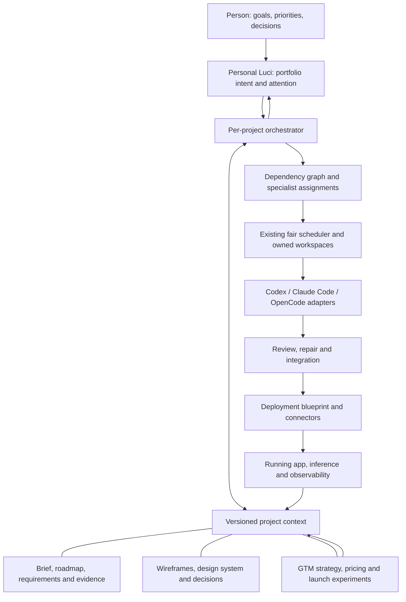

# Luci: the path to 100× leverage

Updated 30 October 2026. Working branch: codex/product-engine-20261029. Baseline: f4801fdc. This is the implementation plan, not a claim that a measured productivity multiplier has been achieved.

## The product we are building

One personal Luci coordinates a portfolio of products. You supply the goal and make material product decisions. Luci maintains the plan, creates visual designs, directs skilled agent teams, integrates their work, manages deployment on your infrastructure, and develops the route to customers and revenue. Each project has its own context, resources and permissions. Multiple projects can progress together.

Discover, Design, Develop, Deploy and Distribute are communicating activities, not a five-page wizard. A customer insight can change a requirement; a requirement can change a wireframe; the change can create parallel implementation work, a new release and updated launch material. The orchestrator carries those changes through.

The website previously reduced this to “build with an agent.” That was a messaging failure. The existing LC-01–24 contract already calls for durable context, orchestrators, communicating swarms, deployment and commercial artifacts. This plan expands concrete missing pieces and prioritizes implementation. It does not replace that contract with a smaller product.

## Where we actually are

We have substantial source foundations. We do not yet have the complete dependable user experience. The correct response is to finish the structures and their connections, not rebuild a coding CLI or repeatedly gate progress on a toy task.

| Area | Existing source we should reuse | Concrete missing work |
|---|---|---|
| Discover | Versioned specifications, requirements, decisions, document evidence, approval and history | Managed roadmap; stronger strategic research and assumption tracking; change impact across all outputs |
| Design | Editable scene canvas, frame navigation, tokens/assets, versioned approval and context export | Strong generated visual-design workflow; explicit distinction between a text plan and a visual design; consistent design-to-task references |
| Develop | Upstream harness adapters, scoped context, scheduler, workspaces, messages, review/check-repair/integration and durable continuation | Skill selection/versioning; better outcome decomposition; a cohesive reliable team experience; useful throughput rather than worker count |
| Portfolio | Project Home/pins/activity, priorities, fair scheduling, global and per-project slots | A causal attention queue, personal cross-project orchestration and capacity/goal allocation |
| Deploy | Local/Pages/Coolify releases, AWS/Azure single-machine provisioning, exact-commit health observations and rollback | Integrated topology/blueprints, customer Kubernetes, inference serving, analytics, broader lifecycle connectors |
| Distribute | Evidence-linked editable drafts and office/document exports | Structured GTM strategy, pricing models, channel experiments, launch connectors and customer/revenue feedback |

Source anchors: specification.go; design_scene.go/design_plan.go; implementation_context.go/orchestration_contract.go; coordinator_background.go; project_swarm*.go; project_home.go; cloud.go/remote_deploy.go; distribute_artifacts.go under control-plane/internal/product. Corresponding app views exist under desktop/src/components.

The source already includes priority aging and cross-project fairness. Do not implement a second scheduler. The source already includes independent review/repair/integration continuation. Do not report those as wholly absent because an older planning note says so. Conversely, a rendered page or a successful package build does not mean the entire product is finished.

## What high-output AI engineering practice implies for Luci

These are concrete practices from primary sources, translated into product requirements. They are not evidence of a universal 100× multiplier.

| Practice | Research | Luci requirement |
|---|---|---|
| Run independent work in parallel with isolated checkouts | The Claude Code team describes several concurrent sessions and worktree isolation. [Power-user practices](https://support.claude.com/en/articles/14554000-claude-code-power-user-tips) | Dependency-aware work partitioning, isolated ownership, specialist skills, integrated review; L100-06–11 |
| Separate planning, execution and evaluation responsibilities | Cursor reports that flat self-coordination created contention and drift, and describes planner/worker/judge responsibilities. [Scaling agents](https://cursor.com/blog/scaling-agents) | A primary orchestrator with explicit task ownership, event-driven replanning and a clear integration path; L100-07–08 |
| Make the environment and project knowledge usable by agents | OpenAI describes structured repository context and agent access to UI, logs and metrics. [Harness engineering](https://openai.com/index/harness-engineering/) | Versioned context packages, visible app state, feedback connectors and reusable operating conventions; L100-05–06,18,24 |
| Continue across sessions without losing the plan | Anthropic describes initialization, incremental work and durable progress artifacts for long-running agents. [Long-running harnesses](https://www.anthropic.com/research/effective-harnesses-for-long-running-agents) | Checkpoints, compact handoffs, resumable tasks and durable project intent; L100-07,24 |
| Reuse the upstream agent harness | OpenAI exposes conversation, turns, events and approval handling through its app-server protocol. [Codex App Server](https://openai.com/index/unlocking-the-codex-harness/) | Improve existing Codex/Claude/OpenCode connectors instead of writing another coding engine; L100-09 |
| Remove downstream delivery bottlenecks | DORA describes platforms that absorb infrastructure complexity and provide clear feedback. [Platform engineering](https://dora.dev/capabilities/platform-engineering/) | Self-service deployment blueprints, repeatable releases, operations and concise intervention queues; L100-12,15–19 |
| Stay grounded in the customer’s problem | Anthropic’s usage research links domain understanding with better direction of agent work. YC emphasizes identifying the problem, initial customer and first useful solution. [Agentic coding expertise](https://www.anthropic.com/research/claude-code-expertise), [Getting and testing ideas](https://www.ycombinator.com/library/7x-how-to-get-and-test-ideas) | Discover research and Distribute customer/offer/channel experiments feed the roadmap; L100-02,20–22 |
| Treat operations and inference as reusable systems | OpenTelemetry defines receivers/processors/exporters for logs, metrics and traces; vLLM publishes a Kubernetes serving stack. [OTel architecture](https://opentelemetry.io/docs/collector/architecture/), [vLLM production stack](https://github.com/vllm-project/vllm/blob/main/docs/deployment/integrations/production-stack.md) | Compose existing components behind typed connectors; separate operational telemetry from product analytics; L100-15–18 |

## Architecture: extend the engine we have

1. **Project context is the source of intent.** Every roadmap phase, visual frame, task and release points to the relevant revision. Context assembly should select what a role needs, not shovel the entire history into every prompt.
2. **Personal Luci allocates attention; project orchestrators own delivery.** Portfolio decisions should explain priority, blockers and available capacity. Project data stays scoped. Cross-project dependencies are explicit records, not accidental shared files.
3. **The existing coordinator performs continuation.** Extend saved events and current review/repair/integration paths. Replanning changes the task graph after results arrive; it does not start an unrelated replacement framework.
4. **Skills are versioned inputs.** A skill record needs ID, version, digest, provenance, licence, role, tool needs and context cost. Tasks freeze their selected skills alongside design/context. Installing or broadening tools remains separate from selecting already-authorized skills.
5. **Connectors separate planning from effects.** A connector describes capabilities, compiles an inspectable plan, observes retained external identities and executes an authorized plan. Unknown external outcomes are reconciled; they are not blindly replayed.
6. **Deploy is a project service graph.** App, database/storage, inference, networking, secrets, telemetry and analytics are linked components. A generated manifest is useful prototype output; cluster creation and service operation are distinct later integrations.
7. **Distribute is a product model, not a pile of generated documents.** Customer segments, positioning, offer, pricing assumptions, channels, launch work and results become editable records. Documents and campaigns render from that model. Customer findings can change Discover and the roadmap.

## Build order

**Wave A — usable structures, now.** Add the managed Discover roadmap, a portfolio intervention queue connected to Home, and a typed deployment blueprint with a no-I/O manifest compiler and plan endpoint. These extend the current app; they are not stand-alone demos.

**Wave B — orchestration quality.** Add versioned skill routing and outcome-driven task decomposition. Connect roadmap outcomes and approved visual frames to agent assignments. Close actual adapter event/continuation gaps and show real coordination state. Finish personal portfolio routing and resource allocation.

**Wave C — infrastructure connectors.** Wire blueprint compilation into Deploy UI. Extend Azure-first bring-your-own infrastructure, cluster lifecycle, model serving and telemetry. Reuse existing deployment authority and observed external identity. Add repeatable preview/promotion/recovery paths. Do not start paid infrastructure during this overnight source pass.

**Wave D — commercial delivery.** Build the structured GTM workspace and pricing model, then generate launch assets from it. Add explicitly authorized publishing and analytics/revenue connectors. Feed findings into the roadmap instead of leaving launch work detached from engineering.

**Wave E — integration and hardening.** After the pieces are connected, run focused checks and representative projects through them. Fix integration and usability defects. Add packaging/signing/device work as a distribution stream; do not make another basic CLI demonstration the gate for implementing the rest of the engine.

## Traceable implementation list

Status meanings: **partial** = relevant existing source, integration still needed; **in_progress** = source implementation under way this turn; **prototype** = new source wired into an interface, with exact test status recorded separately; **planned** = not implemented. These are not release-acceptance labels.

| ID | Area | Capability | Status | Depends on |
|---|---|---|---|---|
| L100-01 | Discover | Managed product roadmap | prototype | Specification revision → roadmap DAG → approved implementation context |
| L100-02 | Discover | Evidence-led product strategy | planned | L100-01 |
| L100-03 | Discover | Adaptive planning and amendment impact | partial | L100-01 |
| L100-04 | Design | Visual wireframes as the shared design contract | partial | L100-01 |
| L100-05 | Design | Reusable design systems and visual implementation guidance | planned | L100-04,L100-06 |
| L100-06 | Develop | Versioned skill registry and assignment | planned | Existing context exporter |
| L100-07 | Develop | Orchestrator decomposition and replanning | partial | L100-01,L100-06 |
| L100-08 | Develop | Parallel teams that integrate their work | partial | L100-07 |
| L100-09 | Develop | Harness connectors with consistent event contracts | partial | Existing harness adapters |
| L100-10 | Develop | Cloud swarm placement and lifecycle | partial | L100-08,L100-09 |
| L100-11 | Develop | Independent review and repair loop | partial | L100-08 |
| L100-12 | Portfolio | One causal attention queue across projects | prototype | Existing project authorization/overview/coordinator |
| L100-13 | Portfolio | Portfolio goal and capacity management | planned | L100-12,L100-07 |
| L100-14 | Portfolio | Persistent personal Luci across projects | partial | L100-12,L100-13 |
| L100-15 | Deploy | Typed deployment blueprint and manifest compiler | prototype | Exact source/config references |
| L100-16 | Deploy | Managed bring-your-own infrastructure connectors | planned | L100-15 |
| L100-17 | Deploy | Inference as a project service | planned | L100-15,L100-16 |
| L100-18 | Deploy | Operational telemetry and product analytics | planned | L100-15,L100-16 |
| L100-19 | Deploy | Continuous preview, release and recovery | partial | L100-08,L100-15 |
| L100-20 | Distribute | Structured go-to-market workspace | planned | L100-01,L100-02 |
| L100-21 | Distribute | Commercial models and launch assets | planned | L100-20 |
| L100-22 | Distribute | Launch connectors and feedback loop | planned | L100-18,L100-20,L100-21 |
| L100-23 | Platform | Reusable solutions through Glasses | partial | L100-05,L100-06 |
| L100-24 | Platform | Memory, checkpoints and restart continuity | partial | L100-07,L100-14 |
| L100-25 | Platform | Outcome and coordination feedback | planned | L100-08,L100-18,L100-22 |
| L100-26 | Delivery | Integrated prototype, then representative testing | planned | L100-01,L100-12,L100-15 |

### Work definitions

**L100-01 — Managed product roadmap**

Existing specification has requirements and decisions; add milestones, outcomes, dependencies, linked requirements and agent-context export.

**L100-02 — Evidence-led product strategy**

Document extraction and source links exist. Add competitive research, target customer, problem hypotheses, opportunity sizing and assumption tracking.

**L100-03 — Adaptive planning and amendment impact**

Versioned amendments and stale-context handling exist. Join requirement changes to roadmap, wireframes, tasks, deployment and GTM impacts.

**L100-04 — Visual wireframes as the shared design contract**

Editable scenes and approval binding exist. Add explicit text-only vs visual design state, responsive flows, interaction coverage and generated design iterations.

**L100-05 — Reusable design systems and visual implementation guidance**

Carry approved components, tokens, assets, accessibility requirements and frame references into each agent task; support versioned design-system reuse.

**L100-06 — Versioned skill registry and assignment**

Existing context snapshots and team standards are not a skill registry. Add skill ID/version/digest/provenance, role matching, context budgets and task-bound selection.

**L100-07 — Orchestrator decomposition and replanning**

Model advice plus durable coordinator already exist. Add outcome-driven plans with specialist roles, write ownership, dependencies and event-triggered replanning; reuse existing execution engine.

**L100-08 — Parallel teams that integrate their work**

Scheduler, reservations, workspaces, messages, review, repair and integration exist. Close provider event/continuation gaps and prevent duplicated or conflicting work.

**L100-09 — Harness connectors with consistent event contracts**

Codex, Claude Code and OpenCode connections exist. Normalize sessions, streaming output, tool approvals, checkpoints, interruption and resumed work behind existing adapters.

**L100-10 — Cloud swarm placement and lifecycle**

Azure foundation/microVM source exists. Complete per-agent ownership, elastic placement, quota/backpressure, retained artifacts and host-loss reconciliation.

**L100-11 — Independent review and repair loop**

Review/check-repair/integration continuation already implemented. Make it visible and reliable as ordinary work, with defect-specific repair and bounded retries.

**L100-12 — One causal attention queue across projects**

Home and priority/fair scheduling exist. Add ranked interventions showing why work is blocked, what it affects, and the exact next action; integrate existing Home.

**L100-13 — Portfolio goal and capacity management**

Build on existing global/per-project slots and priority aging. Add goals, deadlines, resource budgets, dependencies across projects and project-level allocation explanations.

**L100-14 — Persistent personal Luci across projects**

Project-scoped conversation and coordination exist. Add coherent personal briefing, cross-project intent routing and project-specific context boundaries.

**L100-15 — Typed deployment blueprint and manifest compiler**

Existing VM/Coolify/Pages execution remains. Add app/inference/telemetry topology, dependency graph, connector contracts and generated Kubernetes manifests without applying them.

**L100-16 — Managed bring-your-own infrastructure connectors**

Connect blueprint to existing Azure provisioning, then cluster lifecycle, registry, DNS/TLS, secret references, storage and quotas. AWS follows Azure.

**L100-17 — Inference as a project service**

Keep managed local development inference separate from customer production inference. Add model/image/resource selection, serving configuration, health and scaling.

**L100-18 — Operational telemetry and product analytics**

OTel traces/metrics/logs and customer product events are different needs. Add deployment instrumentation plus a product-event schema, destinations and dashboards.

**L100-19 — Continuous preview, release and recovery**

Commit-bound deployment and rollback source exists. Connect branch previews, promotion, release observations and safe recovery; distinguish code rollback from data restore.

**L100-20 — Structured go-to-market workspace**

Evidence-linked draft documents exist. Add editable customer segment, positioning, competitors, offer, pricing assumptions, channels and launch milestones as versioned records.

**L100-21 — Commercial models and launch assets**

Add explicit price/cost/currency/unit economics, pricing experiments, website/campaign/sales/support assets and project-linked publishing drafts.

**L100-22 — Launch connectors and feedback loop**

Add approved channel publishing and analytics/revenue imports; translate findings into roadmap changes. No unsolicited outreach or automatic ad spending.

**L100-23 — Reusable solutions through Glasses**

Existing Glasses integration/catalogue is the starting point. Add task-level reuse recommendations with licences, provenance and compatibility decisions.

**L100-24 — Memory, checkpoints and restart continuity**

Reuse durable snapshots/events rather than accumulating chat history. Add concise role-specific context refresh, decision summaries and recovery across project sessions.

**L100-25 — Outcome and coordination feedback**

Record useful work completed, waiting time, rework, review load, cost and human decisions. Do not equate tokens, agents or lines of code with customer value.

**L100-26 — Integrated prototype, then representative testing**

First join the new structures to the actual app; then run focused tests and representative multi-project journeys. A CLI toy task is not a prerequisite for source implementation.

## Overnight progress

- Website: published at [lcfr.ai/luci](https://lcfr.ai/luci), production dpl_BBoELTyMnouRjXzmVrLw7q42gb7Q. Full product and portfolio story, understated passive globe, green/cream layout; public HTML/assets and desktop/phone checks passed.
- Discover roadmap: source prototype complete and independently reviewed. Adds milestones, linked requirements, dependencies, approval validation, an editor and agent-context export.
- Portfolio intervention queue: source prototype complete and independently reviewed. Home now ranks decisions and blockers from existing project/run records with exact navigation.
- Deployment blueprint/compiler: source prototype complete and independently reviewed. Produces Kubernetes app/inference Deployment and Service manifests from explicit inputs; provider application is the next connector task.
- Focused checks: 51 named Go cases and 39 frontend cases selected, plus TypeScript checking; not yet executed.
- Research and 26-item backlog: written.

The machine-readable companion is [luci-100x-backlog.json](luci-100x-backlog.json). This section and that file will be updated with the actual source/test/publication result before handoff. The prior recurring automation remains deleted. No native app launch or new cloud resources are part of this overnight pass.
