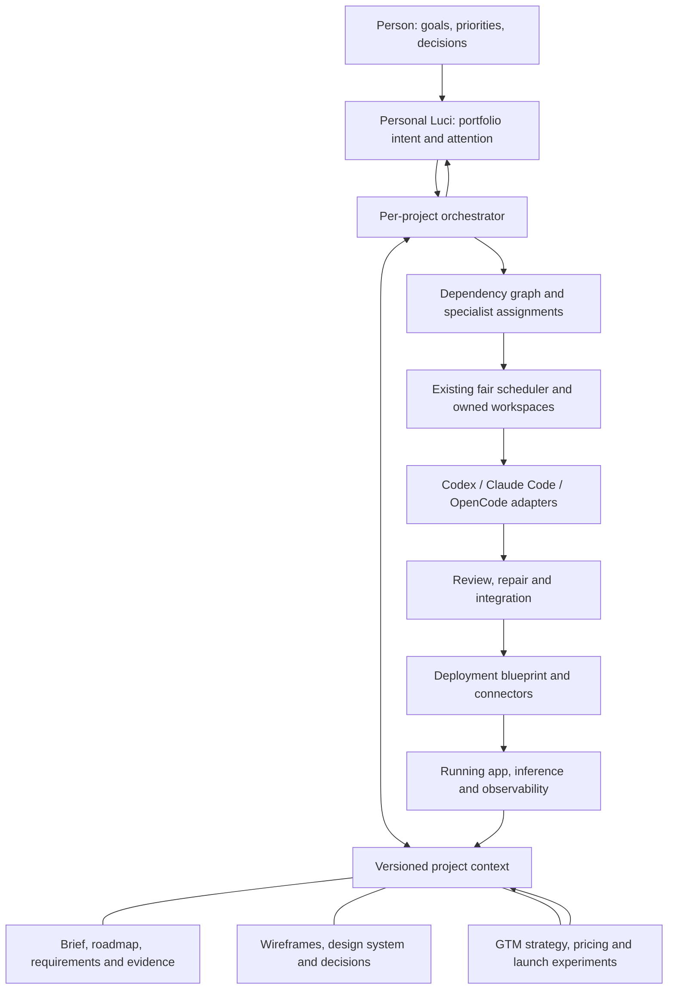

# Luci: the path to 100× leverage

Updated 31 October 2026. Working branch: codex/product-engine-20261029. Baseline: f4801fdc. This is the implementation plan, not a claim that a measured productivity multiplier has been achieved.

## The product

One personal Luci coordinates a portfolio of products. You supply the goal and make material product decisions. Luci maintains the plan, creates visual designs, directs skilled agent teams, integrates their work, manages deployment on your infrastructure, and develops the route to customers and revenue. Each project has its own context, resources and permissions. Multiple projects can progress together.

Discover, Design, Develop, Deploy and Distribute are communicating activities, not a five-page wizard. A customer insight can change a requirement; a requirement can change a wireframe; the change can create parallel implementation work, a new release and updated launch material. The orchestrator carries those changes through.

The website previously reduced this to “build with an agent.” That was a messaging failure. The existing LC-01–24 contract already calls for durable context, orchestrators, communicating swarms, deployment and commercial artifacts. This plan expands concrete missing pieces and prioritizes implementation. It does not replace that contract with a smaller product.

## 31 October completeness review — implementation is not finished

The 3bd01c06 internal candidate compiled and was packaged. That established a buildable snapshot, not a complete Luci product. Current source review found missing implementation, not merely missing test evidence. The latest owner instruction resumes implementation and allows product testing once the implementation is ready; recurring automation remains deleted.

| User expectation | Actual source finding | Implementation response |
|---|---|---|
| Appearance and compactness choices, clear project cards | System/light/dark and three accents already persisted; only two densities, hardcoded Home spacing and weak card separation; failed storage looked saved | Add spacious density, independent surface contrast, actual shared spacing/control tokens, visible project surfaces, narrow five-D navigation and truthful current-window-only feedback |
| Discover produces a useful product strategy | Specifications and roadmap exist; no typed customer/problem/alternative/assumption/success model | Add strategy to the existing revisioned specification, source-linked assumptions, requirement impact links and downstream context; external research collection remains a separate connector |
| Visual design is a usable shared contract | Initial review found awkward variant/coverage flows and no reusable semantic components; both now have integrated source | Integrated copy-and-adapt frame variants, coverage navigation, saved Design history and reusable token-bound semantic components with reviewed cross-project import. Absolute-positioned wireframes remain a design contract, not responsive implementation code |
| Agent teams finish and integrate work without terminal babysitting | Scheduler, isolated work, review, repair and integration exist; ordinary final output is not a dependable structured result | Integrated exact completion contracts for Codex, Claude Code and OpenCode, preserving upstream harness behavior and original-container normal-zero eligibility. Fixed reviewer selection for rebuilt tasks/prerequisites and added concise role context. Matching runtime-image packaging/activation and representative product testing remain |
| Luci allocates attention across projects | Goals and queued priorities exist, but focus slots and project dependencies were advisory | Enforce explicitly reviewed actor/team focus ceilings and exact accepted-upstream-run dependencies in the existing scheduler; keep actual resource/authority ceilings and fairness |
| Deployment configuration survives ordinary use | Blueprint compiler/UI existed, but topology lived only in component state | Save and reload project-private versioned topology with CAS, conflict-preserved drafts and bounded retained history |
| Luci runs Kubernetes, inference and analytics on owned infrastructure | Existing releases and Azure VM foundation are executable paths; Kubernetes manifests are compiler output, not cluster/service execution | Integrated owned AKS creation/access/namespace commissioning, existing-cluster setup, blueprint review/Apply/Observe, inference health and existing Secret/PVC references, Collector deployment/instrumentation and owned product counters. Automatic GPU/model/storage/registry/DNS provisioning and operational log/trace queries remain; no live cluster was used |
| Luci helps sell the product and learns from results | GTM, commercial scenarios and launch drafts exist; publishing and customer/revenue ingestion do not | Integrated selected GitHub issue findings and explicit aggregate CSV analytics/revenue imports into the existing GTM/context workflow. Integrated recoverable GTM history continuation beyond 50 revisions; reviewed GitHub release draft/publication with original-outcome recovery is now integrated |
| One personal Luci oversees the whole portfolio | Project conversations and private goal-to-work routing exist | Integrated private actor-wide conversation, archived transcript continuation and explicit reviewed project handoff, including interrupted-request recovery. It reuses current project compute/authority and does not turn private chat into automatic project execution |

### Research refreshed for this review

[OpenAI's harness-engineering report](https://openai.com/index/harness-engineering/) describes agent-legible environments, durable repository knowledge and feedback loops. For Luci this means the selected worker must receive useful context and access to the actual application, logs and metrics; an export file or a successful compiler is insufficient.

[Anthropic's March 2026 long-running application study](https://www.anthropic.com/research/harness-design-long-running-apps) separates planning, generation and evaluation, with concrete sprint contracts and an evaluator exercising the application. Luci already has independent review/repair machinery; finish its result handoff and make usability criteria part of the reviewed task contract. Do not replace the selected upstream harness's own compaction with a second competing model loop.

[Cursor's multi-agent coordination research](https://cursor.com/blog/scaling-agents) shows why uncontrolled flat coordination can stall and why clear responsibilities matter. Apply this through existing DAG ownership, fair scheduling, actual focus constraints and event-driven continuation. More agents or generated lines alone are not a useful outcome measure.

[Anthropic's current Claude Code guidance](https://code.claude.com/docs/en/best-practices) distinguishes model guidance from mechanically enforced constraints. Skills convey expertise; resource limits, isolation, exact authority and observable completion belong in Luci's engine. Its user should not have to manually babysit routine compliance.

The 100× ambition remains the product direction, not a measured universal productivity guarantee. The useful target is more accepted outcomes across concurrent projects with less waiting, rework and human intervention.

### Current integration batch

The first implementation cut is committed at 4f64dca4; f3e5cb81 corrects a frontend test type-name collision without changing production behavior. The Windows API, Linux worker daemon, TypeScript and frontend bundle compile. This is an intermediate source build; the installed 3bd01c06 candidate is unchanged and product tests have not started.

The second source batch now integrates private portfolio conversation/history/recovery, reusable Design components, inference probes/resource references/owned observations, selected GitHub findings, project-task Glasses reuse, assisted deployment topology, three-harness completion contracts, reviewer closure, manual deployment fresh-authority checks and aggregate analytics/revenue import. Distribute puts the launch plan and assets before secondary team controls. The final source cut contains 223 changed code files, including 132 Go files. Formatting/compilation and a matching native/runtime-source package are next; no product tests have started.

Assisted topology proposals now use the existing orchestrator and transfer into the actual saved Deploy editor. Collector/instrumentation/owned product-counter observation and cross-stage amendment impact are now integrated. Owned AKS commissioning/recovery and recoverable GTM history continuation are also integrated. The explicit reviewed GitHub release connector is integrated, including original-attempt recovery and preservation of unsaved preparation. Collector lifecycle, application instrumentation and product analytics are separate from readiness probes or environment variables. [OpenTelemetry describes the actual receiver/processor/exporter pipeline](https://opentelemetry.io/docs/collector/architecture/) and provides a [Kubernetes Collector chart](https://opentelemetry.io/docs/platforms/kubernetes/helm/collector/). Do not add an unsupported production-stack promise: [PostHog currently describes its self-hosted distribution as unsupported](https://posthog.com/docs/self-host), so a product-analytics connector needs an explicit supported deployment or existing-service choice.

### Review and testing boundary

Three existing specialist roles independently trace and review source; root integrates their work. This pass reviews actual call chains, state preservation, authority, accessibility semantics, density propagation and recovery behavior. It has not run a new rendered UI/UX review or a representative product test. New regression cases are authored but their execution status is recorded separately. Do not turn source review into a claim that the whole app is ready.

This source cut also adds an on-demand outcome summary from retained accepted-work, queue and review/repair records. It does not infer productivity from agent counts or claim lifetime/live-health statistics.

The installed/package snapshot remains the earlier 3bd01c06 candidate until a new source freeze is compiled and staged. New source is not silently present in that executable. Full application acceptance remains false.

## Where we actually are

We have substantial source foundations. We do not yet have the complete dependable user experience. The correct response is to finish the structures and their connections, not rebuild a coding CLI or repeatedly gate progress on a toy task.

| Area | Existing source we should reuse | Concrete missing work |
|---|---|---|
| Discover | Versioned specifications, roadmap, requirements, decisions, document evidence, approval/history and typed strategy with assumptions and measurements | External research collection and findings-to-reviewed-amendment routing remain |
| Design | Editable canvas, variants, coverage, history, tokens/assets, reusable components, approved task-bound context and existing model scene proposals | Compile/integrate the current source and exercise actual designer-to-agent journeys; wireframes do not themselves implement responsive applications |
| Develop | Three-harness result contracts, task-bound skills/reuse, fair scheduler, workspaces, durable messages, independent review/repair, ordered scoped integration and renewed approvals | Package matching runtime assets, compile the current source and exercise useful parallel throughput; unknown receipts/conflicts remain explicit review cases |
| Portfolio | Home/pins/activity, private portfolio conversation/history/project handoff, goals, focus ceilings and exact accepted-run dependencies enforced in the scheduler | Compile the integrated personal conversation and exercise multiple concurrent projects with real upstream agents |
| Deploy | Local/Pages/Coolify releases, VM foundation, saved assisted topology, owned AKS setup/access/namespace, Kubernetes review/apply/observe, inference probes and existing references, Collector/instrumentation/product counters | Automatic GPU/model/storage/registry/DNS lifecycle and operational log/trace query interface remain; current source still requires compilation and authorized commissioning |
| Distribute | Structured GTM/commercial scenarios, reviewed launch assets and document exports, selected issue feedback, aggregate metric imports and recoverable history | Compile/package and exercise the integrated GitHub release connector; authenticated provider-specific revenue and other publishing channels remain |

Source anchors: specification.go; design_scene.go/design_plan.go; implementation_context.go/orchestration_contract.go; coordinator_background.go; project_swarm*.go; project_home.go; cloud.go/remote_deploy.go; distribute_artifacts.go under control-plane/internal/product. Corresponding app views exist under desktop/src/components.

The source already includes priority aging and cross-project fairness. Do not implement a second scheduler. The source already includes independent review/repair/integration continuation. Do not report those as wholly absent because an older planning note says so. Conversely, a rendered page or a successful package build does not mean the entire product is finished.

## What high-output AI engineering practice implies for Luci

These are concrete practices from primary sources, translated into product requirements. They are not evidence of a universal 100× multiplier.

| Practice | Research | Luci requirement |
|---|---|---|
| Run independent work in parallel with isolated checkouts | The Claude Code team describes several concurrent sessions and worktree isolation. [Power-user practices](https://support.claude.com/en/articles/14554000-claude-code-power-user-tips) | Dependency-aware work partitioning, isolated ownership, specialist skills, integrated review; L100-06–11 |
| Separate planning, execution and evaluation responsibilities | Cursor reports that flat self-coordination created contention and drift, and describes planner/worker/judge responsibilities. [Scaling agents](https://cursor.com/blog/scaling-agents) | A primary orchestrator with explicit task ownership, event-driven replanning and a clear integration path; L100-07–08 |
| Make the environment and project knowledge usable by agents | OpenAI describes structured repository context and agent access to UI, logs and metrics. [Harness engineering](https://openai.com/index/harness-engineering/) | Versioned context packages, visible app state, feedback connectors and reusable operating conventions; L100-05–06,18,24 |
| Continue across sessions without losing the plan | Anthropic describes initialization, incremental work and durable progress artifacts for long-running agents. [Long-running harnesses](https://www.anthropic.com/research/effective-harnesses-for-long-running-agents) | Checkpoints, compact handoffs, resumable tasks and durable project intent; L100-07,24 |
| Reuse the upstream agent harness | OpenAI exposes conversation, turns, events and approval handling through its app-server protocol. [Codex App Server](https://openai.com/index/unlocking-the-codex-harness/) | Improve existing Codex/Claude/OpenCode connectors instead of writing another coding engine; L100-09 |
| Remove downstream delivery bottlenecks | DORA describes platforms that absorb infrastructure complexity and provide clear feedback. [Platform engineering](https://dora.dev/capabilities/platform-engineering/) | Self-service deployment blueprints, repeatable releases, operations and concise intervention queues; L100-12,15–19 |
| Stay grounded in the customer’s problem | Anthropic’s usage research links domain understanding with better direction of agent work. YC emphasizes identifying the problem, initial customer and first useful solution. [Agentic coding expertise](https://www.anthropic.com/research/claude-code-expertise), [Getting and testing ideas](https://www.ycombinator.com/library/7x-how-to-get-and-test-ideas) | Discover research and Distribute customer/offer/channel experiments feed the roadmap; L100-02,20–22 |
| Treat operations and inference as reusable systems | OpenTelemetry defines receivers/processors/exporters for logs, metrics and traces; vLLM publishes a Kubernetes serving stack. [OTel architecture](https://opentelemetry.io/docs/collector/architecture/), [vLLM production stack](https://github.com/vllm-project/vllm/blob/main/docs/deployment/integrations/production-stack.md) | Compose existing components behind typed connectors; separate operational telemetry from product analytics; L100-15–18 |

## Architecture: extend the engine we have

1. **Project context is the source of intent.** Every roadmap phase, visual frame, task and release points to the relevant revision. Context assembly should select what a role needs, not shovel the entire history into every prompt.
2. **Personal Luci allocates attention; project orchestrators own delivery.** Portfolio decisions should explain priority, blockers and available capacity. Project data stays scoped. Cross-project dependencies are explicit records, not accidental shared files.
3. **The existing coordinator performs continuation.** Extend saved events and current review/repair/integration paths. Replanning changes the task graph after results arrive; it does not start an unrelated replacement framework.
4. **Skills are versioned inputs.** A skill record needs ID, version, digest, provenance, licence, role, tool needs and context cost. Tasks freeze their selected skills alongside design/context. Installing or broadening tools remains separate from selecting already-authorized skills.
5. **Connectors separate planning from effects.** A connector describes capabilities, compiles an inspectable plan, observes retained external identities and executes an authorized plan. Unknown external outcomes are reconciled; they are not blindly replayed.
6. **Deploy is a project service graph.** App, database/storage, inference, networking, secrets, telemetry and analytics are linked components. A generated manifest is useful prototype output; cluster creation and service operation are distinct later integrations.
7. **Distribute is a product model, not a pile of generated documents.** Customer segments, positioning, offer, pricing assumptions, channels, launch work and results become editable records. Documents and campaigns render from that model. Customer findings can change Discover and the roadmap.

## Build order

**Wave A — usable structures, now.** Add the managed Discover roadmap, a portfolio intervention queue connected to Home, and a typed deployment blueprint with a no-I/O manifest compiler and plan endpoint. These extend the current app; they are not stand-alone demos.

**Wave B — orchestration quality.** Add versioned skill routing and outcome-driven task decomposition. Connect roadmap outcomes and approved visual frames to agent assignments. Close actual adapter event/continuation gaps and show real coordination state. Finish personal portfolio routing and resource allocation.

**Wave C — infrastructure connectors.** Wire blueprint compilation into Deploy UI. Extend Azure-first bring-your-own infrastructure, cluster lifecycle, model serving and telemetry. Reuse existing deployment authority and observed external identity. Add repeatable preview/promotion/recovery paths. Do not start paid infrastructure during this overnight source pass.

**Wave D — commercial delivery.** Build the structured GTM workspace and pricing model, then generate launch assets from it. Add explicitly authorized publishing and analytics/revenue connectors. Feed findings into the roadmap instead of leaving launch work detached from engineering.

**Wave E — integration and hardening.** After the pieces are connected, run focused checks and representative projects through them. Fix integration and usability defects. Add packaging/signing/device work as a distribution stream; do not make another basic CLI demonstration the gate for implementing the rest of the engine.

## Traceable implementation list

Status meanings: **partial** = relevant existing source, integration still needed; **in_progress** = source implementation under way this turn; **prototype** = new source wired into an interface, with exact test status recorded separately; **planned** = not implemented. These are not release-acceptance labels.

| ID | Area | Capability | Status | Depends on |
|---|---|---|---|---|
| L100-01 | Discover | Managed product roadmap | prototype | Specification revision → roadmap DAG → approved implementation context |
| L100-02 | Discover | Evidence-led product strategy | prototype | L100-01 |
| L100-03 | Discover | Adaptive planning and amendment impact | prototype | L100-01 |
| L100-04 | Design | Visual wireframes as the shared design contract | prototype | L100-01 |
| L100-05 | Design | Reusable design systems and visual implementation guidance | prototype | L100-04,L100-06 |
| L100-06 | Develop | Versioned skill registry and assignment | prototype | Existing context exporter |
| L100-07 | Develop | Orchestrator decomposition and replanning | prototype | L100-01,L100-06 |
| L100-08 | Develop | Parallel teams that integrate their work | prototype | L100-07 |
| L100-09 | Develop | Harness connectors with consistent event contracts | prototype | Existing harness adapters |
| L100-10 | Develop | Cloud swarm placement and lifecycle | partial | L100-08,L100-09 |
| L100-11 | Develop | Independent review and repair loop | prototype | L100-08 |
| L100-12 | Portfolio | One causal attention queue across projects | prototype | Existing project authorization/overview/coordinator |
| L100-13 | Portfolio | Portfolio goal and capacity management | prototype | L100-12,L100-07 |
| L100-14 | Portfolio | Persistent personal Luci across projects | prototype | L100-12,L100-13 |
| L100-15 | Deploy | Typed deployment blueprint and manifest compiler | prototype | Exact source/config references |
| L100-16 | Deploy | Managed bring-your-own infrastructure connectors | prototype | L100-15 |
| L100-17 | Deploy | Inference as a project service | prototype | L100-15,L100-16 |
| L100-18 | Deploy | Operational telemetry and product analytics | prototype | L100-15,L100-16 |
| L100-19 | Deploy | Continuous preview, release and recovery | prototype | L100-08,L100-15 |
| L100-20 | Distribute | Structured go-to-market workspace | prototype | L100-01,L100-02 |
| L100-21 | Distribute | Commercial models and launch assets | prototype | L100-20 |
| L100-22 | Distribute | Launch connectors and feedback loop | prototype | L100-18,L100-20,L100-21 |
| L100-23 | Platform | Reusable solutions through Glasses | prototype | L100-05,L100-06 |
| L100-24 | Platform | Memory, checkpoints and restart continuity | prototype | L100-07,L100-14 |
| L100-25 | Platform | Outcome and coordination feedback | prototype | L100-08,L100-18,L100-22 |
| L100-26 | Delivery | Integrated prototype, then representative testing | in_progress | L100-01,L100-12,L100-15 |
| L100-27 | Experience | Appearance, density, contrast and clear project surfaces | prototype | Existing appearance/settings/Home |

### Work definitions

**L100-01 — Managed product roadmap**

Existing specification has requirements and decisions; add milestones, outcomes, dependencies, linked requirements and agent-context export.

**L100-02 — Evidence-led product strategy**

Document extraction and source links exist. Add competitive research, target customer, problem hypotheses, opportunity sizing and assumption tracking.

**L100-03 — Adaptive planning and amendment impact**

Versioned amendments and stale-context handling exist. Join requirement changes to roadmap, wireframes, tasks, deployment and GTM impacts.

**L100-04 — Visual wireframes as the shared design contract**

Editable scenes and approval binding exist. Add explicit text-only vs visual design state, responsive flows, interaction coverage and generated design iterations.

**L100-05 — Reusable design systems and visual implementation guidance**

Carry approved components, tokens, assets, accessibility requirements and frame references into each agent task; support versioned design-system reuse.

**L100-06 — Versioned skill registry and assignment**

Existing context snapshots and team standards are not a skill registry. Add skill ID/version/digest/provenance, role matching, context budgets and task-bound selection.

**L100-07 — Orchestrator decomposition and replanning**

Model advice plus durable coordinator already exist. Add outcome-driven plans with specialist roles, write ownership, dependencies and event-triggered replanning; reuse existing execution engine.

**L100-08 — Parallel teams that integrate their work**

Scheduler, reservations, workspaces, messages, review, repair and integration exist. Close provider event/continuation gaps and prevent duplicated or conflicting work.

**L100-09 — Harness connectors with consistent event contracts**

Codex, Claude Code and OpenCode connections exist. Normalize sessions, streaming output, tool approvals, checkpoints, interruption and resumed work behind existing adapters.

**L100-10 — Cloud swarm placement and lifecycle**

Azure foundation/microVM source exists. Complete per-agent ownership, elastic placement, quota/backpressure, retained artifacts and host-loss reconciliation.

**L100-11 — Independent review and repair loop**

Review/check-repair/integration continuation already implemented. Make it visible and reliable as ordinary work, with defect-specific repair and bounded retries.

**L100-12 — One causal attention queue across projects**

Home and priority/fair scheduling exist. Add ranked interventions showing why work is blocked, what it affects, and the exact next action; integrate existing Home.

**L100-13 — Portfolio goal and capacity management**

Build on existing global/per-project slots and priority aging. Add goals, deadlines, resource budgets, dependencies across projects and project-level allocation explanations.

**L100-14 — Persistent personal Luci across projects**

Project-scoped conversation and coordination exist. Add coherent personal briefing, cross-project intent routing and project-specific context boundaries.

**L100-15 — Typed deployment blueprint and manifest compiler**

Existing VM/Coolify/Pages execution remains. Add app/inference/telemetry topology, dependency graph, connector contracts and generated Kubernetes manifests without applying them.

**L100-16 — Managed bring-your-own infrastructure connectors**

Connect blueprint to existing Azure provisioning, then cluster lifecycle, registry, DNS/TLS, secret references, storage and quotas. AWS follows Azure.

**L100-17 — Inference as a project service**

Keep managed local development inference separate from customer production inference. Add model/image/resource selection, serving configuration, health and scaling.

**L100-18 — Operational telemetry and product analytics**

OTel traces/metrics/logs and customer product events are different needs. Add deployment instrumentation plus a product-event schema, destinations and dashboards.

**L100-19 — Continuous preview, release and recovery**

Commit-bound deployment and rollback source exists. Connect branch previews, promotion, release observations and safe recovery; distinguish code rollback from data restore.

**L100-20 — Structured go-to-market workspace**

Evidence-linked draft documents exist. Add editable customer segment, positioning, competitors, offer, pricing assumptions, channels and launch milestones as versioned records.

**L100-21 — Commercial models and launch assets**

Add explicit price/cost/currency/unit economics, pricing experiments, website/campaign/sales/support assets and project-linked publishing drafts.

**L100-22 — Launch connectors and feedback loop**

Add approved channel publishing and analytics/revenue imports; translate findings into roadmap changes. No unsolicited outreach or automatic ad spending.

**L100-23 — Reusable solutions through Glasses**

Existing Glasses integration/catalogue is the starting point. Add task-level reuse recommendations with licences, provenance and compatibility decisions.

**L100-24 — Memory, checkpoints and restart continuity**

Reuse durable snapshots/events rather than accumulating chat history. Add concise role-specific context refresh, decision summaries and recovery across project sessions.

**L100-25 — Outcome and coordination feedback**

Record useful work completed, waiting time, rework, review load, cost and human decisions. Do not equate tokens, agents or lines of code with customer value.

**L100-26 — Integrated prototype, then representative testing**

First join the new structures to the actual app; then run focused tests and representative multi-project journeys. A CLI toy task is not a prerequisite for source implementation.

## Current implementation progress

The current implementation is broader than the installed 3bd01c06 candidate. The following table describes source wired into the app, with unfinished implementation separated from verification. No current-source product test or new rendered usability pass has started.

| Area | Connected source | Remaining implementation or delivery |
|---|---|---|
| Discover | Versioned definition, strategy, assumptions/evidence, roadmap/dependencies, model proposals, structural amendment/rebase and explicit cross-stage impact | A dedicated external research collection connector is not implemented; supplied research and configured agent tools remain the source path. Representative change-propagation testing is pending |
| Design | Editable visual scenes, approved task references, width/state variants, coverage, saved history, token-bound reusable components and reviewed library import | Compile and exercise model-assisted design and responsive implementation through actual workers; a wireframe is not the final application |
| Develop | Saved skills and Glasses reuse, task ownership/workspaces, fair scheduler, enforced portfolio focus, independent reviewers/repairs, ordered integration and three-harness result contracts | Matching runtime assets/image commissioning, useful concurrent-work testing and failure/restart exercises |
| Personal Luci | Private portfolio conversation, retained/archive history, project selection, compute selection, reviewed project handoff and interrupted-request reconciliation | Compile and exercise account/workspace isolation, long history and multi-project decisions |
| Deploy | Versioned assisted topology, existing-cluster target/review/apply/observe, inference health/reference/PVC binding, Collector configuration, application instrumentation handoff and owned product-event counters | Final owned-AKS source correction/integration. Automated GPU/model/storage/registry provisioning and operational logs/traces exploration remain outside the implemented existing-resource path |
| Distribute | Structured GTM and pricing scenarios, saved launch assets, selected GitHub findings, CSV analytics/revenue imports and findings-to-project discussion | Finish durable GTM continuation and the reviewed GitHub release connector. Other publishing channels and authenticated revenue-provider integrations remain open |
| Experience | Three densities, three accents, system/light/dark appearance, independent surface contrast, shared project-card surfaces and persisted preferences | Rendered contrast/reflow, navigation, keyboard and representative usability review are still pending |

The implementation does not become complete merely because a build succeeds. Conversely, historical source features are not missing just because an older plan listed them as future work. The backlog now distinguishes new source, residual capabilities, packaging and validation.

### Historical source checks and the 30 October build

The prior eight-prototype source at eab0c9d1 passed its focused checks: portfolio/launch Go39, frontend44 plus the two exact store cases, and the policy regression24 with full TypeScript exit0. Earlier source batches have their own retained results. The earlier TypeScript failure, fixture failures, duplicate-title rejection and skipped targeted run remain recorded; they were not retrospectively counted as successful runs.

The new routing, skill-recommendation and Azure-foundation source is independently reviewed and formatted. Its first focused pass returned Go70/72 and frontend249/253. The six failures were in four new test fixtures: missing fixture route registration, an invalid fixture run ID, an SSH label matcher that ignored existing help text, and an incomplete CloudPlan mock. Those fixtures are corrected without changing production guards. The narrow two-Go/four-frontend rerun and full TypeScript pass subsequently passed at 3bd01c06. API, web and native artifacts were compiled and an internal 543-file standalone candidate was staged. This did not establish full product completion. Source checks, compiled artifacts and ordinary native/user journeys are tracked separately. The existing native lock hold is still respected; no native/model session or live Azure operation is part of this source implementation pass.

### Next work, in order

1. The current connector/recovery source slices and independent reviews are integrated. Preserve their exact source and recovery boundaries through the build.
2. Formatting completed normally for all 132 changed Go files. Commit and compile the exact joined source, then package the matching native app and runtime sources; preserve the older candidate separately.
3. Resolve the explicit remaining implementation boundaries listed above before declaring the whole product finished. Do not substitute a successful compiler for missing capability.
4. Once the supported implementation is ready, run focused regression suites and representative multi-project journeys, then repair the integration and usability defects they expose. Native access and live infrastructure keep their actual authority requirements.

The machine-readable companion is [luci-100x-backlog.json](luci-100x-backlog.json). Each item records remaining work. Earlier source is on [draft PR #7](https://github.com/lcfrai/luci/pull/7); the first 31 October implementation cut is committed locally at 4f64dca4 with the type-only f3e5cb81 correction. The next integration batch is in progress and has not been committed or pushed. Native user-journey acceptance, cloud execution and full product acceptance remain unfinished; they do not block implementing the next source structures.
