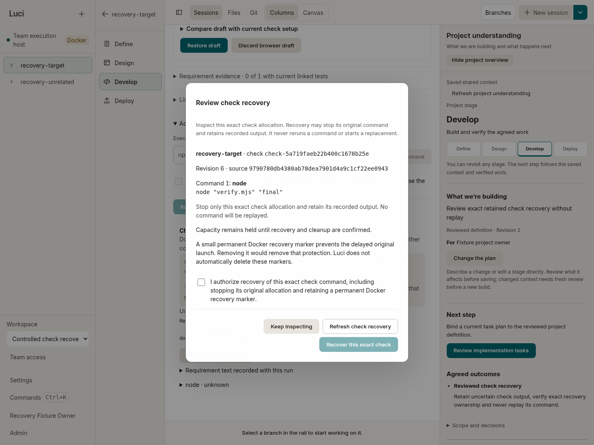

# Check recovery attempt 8 — passed installed reviewed recovery

This matching installed Linux attempt **passed its overall bounded recovery harness**, using **product/helper `2da1a821b8456c20a858fb86ef87649ea917d9de`**. An actual lost-Create-acknowledgement check was reviewed and explicitly cancelled through the UI; exact positive fence proof released its **1,024 MiB / 1,000 mCPU** charge. The original command was never started or replayed, and a permanent image-free marker remained. The recovered target is **cancelled and unverified, not a passing check**.

Driver timestamps: `2026-10-09T01:47:30.344Z`–`01:48:42.900Z` (**11:47–11:48 a.m. Brisbane**, 9 October). Wrapper exit **0**. This is a scoped Linux/API/browser/Docker recovery result, not full local-product completion, Windows acceptance, concurrent charged-witness isolation, sustained four-project performance or live-model quality.

## Actual workflow

1. Historical check `check-d2e8f78bfcd63fd36a3f3974` in `p-3667e573` actually ran `node verify.mjs final`, exited **0**, produced `RECOVERY_CHECK_OK`, and confirmed exact cleanup/release. That nonempty history and both projects' source were preserved.
2. The user-facing controls consented once to target `check-5a719faeb22b400c1678b25e` in `p-1cb2afc2`. Docker returned Create **201** for immutable container `d8d410410a198ff579f6b75eebd11701db1209a9f6f0643c1ce2d499ae5f6171`. The proxy drained then deliberately lost that ACK; the product naturally recorded **unknown / check_create_unconfirmed**, with no target Start and exact charged allocation `checkexec-1050be441a70586a2442be85`.
3. Opening/dismissing recovery review caused no source, ledger, receipt or Docker mutation. A reviewed editor whose Edit grant was revoked received **403**; a stale reviewed revision received **409**. Current review remained coherent across subsequent reads/refusal probes.
4. The owner reviewed the exact check, explicitly acknowledged recovery and sent **one** successful UI recovery POST with exact current revision/digest. The transport bound original **Delete 204**, absence, fence **Create 201**, and exact inert-marker inspection to the persisted **retired** proof. Whole private-ledger charge and the owner's public reservation view fell from **1 / 1,024 MiB / 1,000 mCPU** to **0 / 0 / 0**.
5. Final target revision **9** is **cancelled / check_stopped_by_review**, `resourcesHeld=false`, `evidenceStatus=unverified`. Command cleanup is confirmed; empty output, command/source identity and null/absent exit code are preserved. Recovery GET reports complete without a further method/digest. The UI explicitly says recovery does not establish passing checks.
6. All controller/proxy/browser cleanup phases and five startup handles closed normally. Positive proxy drain reported zero pending requests/handlers/body bytes and no uncertain mutation. The final adapter—not merely the scenario—set `passed=true`.

The raw nested `scenario` deliberately retains `passed=false` / `cleanupPending=true`: it returns before ownership settlement and cannot itself certify cleanup. The enclosing final report records completed cleanup and overall `passed=true`. Neither captured field is rewritten.

## Transport and remaining scope

Exact totals: **3 Creates (2 ordinary checks + 1 fence), 1 historical Start, 0 target Starts, 0 workers/model calls**, 0 dropped rows and an **empty failure list**. Seven exact owned-check statistics GETs completed **200** with retained safe query **`?one-shot=1&stream=0`**, giving scoped installed positive evidence for CLOUD-040. The six original refusal rows in attempt 6 remain a separate failure; this does not reconstruct their missing raw queries.

This run exercises current review/coherent observation and reviewed fence recovery, but **not the original view-before-first-observer ordering**: the helper reads the target to settle post-failure observation before opening review. CLOUD-038's specific ordering remains separately covered by its controlled regression. CLOUD-039's real matching lost-ACK gate path/advisory preflight was used; its terminal-before-gate refusal branch was **not exercised**. The optional **concurrent charged witness was not enabled**. Unrelated completed history/source preservation is supported; concurrent charged-allocation isolation is not claimed from this run.

The exact current target API result is included in [attempt-outcome.json](attempt-outcome.json) and the [complete original report](result/report.json.gz). All 18 phase receipts, journal, three screenshots and raw observer rows are retained.

## Package and closure

The [package receipt](package/package-integrity.json) records **3,587 matching members**, 347 licensed components, zero missing licenses. Archive SHA-256 `078f0689489d51583fb58f46846da9d13156845e6f647e90b744696aa3c7c09e`; binary SHA-256 `e1dd6db97f506b7be2b2efff9bc9a774de79469f707f924f80e717746d92c29b`; image `sha256:333effcf40151e2411fa036b4581113be2af7f8d441bf9566f1cce6e7f208e98`. All **11 captured executing helpers** match exact `2da1a821` Git bytes. Archive/image upload or independent binary retrieval is not claimed.

At driver closure, Docker retained only permanent marker **`4b9b07e96a0f5afdd7e5aa3118c707544905a993212948c4064a360f874e8373`**, with zero volumes/active check leases. Raw private ledger SHA-256 is `30aafe64b8387f1681f447b1a1ffa4c13c242cd9710c0a71e0c9fe114cf6f8c1`. The separate root [read-only closure](independent-scoped-closure.json) at `01:53:47.067746Z` confirms the same exact marker/proof and **110 fixture files unchanged**. Of **15 recorded identities**, **13 were absent and two remained exited Chromium zombies adopted by PID 1**; three other process environments were unreadable. This is not whole-machine process absence.

The [marker inspection](retained-marker-inspection.json) records created/never-started/PID 0, no image/mounts/environment/network, read-only root, dropped capabilities, one PID, and 6 MiB/100 mCPU bounds. It is intentional launch protection, not a running worker. The [retired proof](retained-fence-proof.json) remains intact. **An empty active ledger is not an empty Docker inventory.** Any later terminal fixture archival/marker removal is a separate operation and cannot substitute for this product release proof. This capsule does not claim such retirement occurred within the run.

Raw fixture inventory/auth/ledger bytes remain private, and their invariance/package verification are publisher-held receipts. Publication made no daemon call, signal, application launch or fixture mutation. Original failed fixtures remain separate and untouched.

## Resources and reproducibility

All **91 samples over 93.519 seconds** are retained. There are **68 observed control-plane samples / 136 cgroup rows** with **zero independently recomputed formula mismatches**. Minimum sampled effective available memory is **10,609,967,104 bytes**, minimum physical available **21,636,657,152 bytes**. Sequential observations do not establish atomic admission or the cause of attempt 7's refusal.

Check coverage is **6 identity samples / 0 usage samples**. The observer retains 21 explicit `check-label-set-invalid` observations for the inert marker rather than treating it as a runnable check. Summed owned-process RSS peaks at **1,250,889,728 bytes**, potentially double-counting shared pages; control-plane peak is **236,961,792**, browser **849,481,728**. Observer interpreter cost is about **0.22031 CPU core**, excluding children/daemon and not subtracted. No pre-run idle, sustained throughput, latency or whole-computer responsiveness conclusion is drawn.

[REPRODUCE.md](REPRODUCE.md) gives exact setup/pin/invocation and read-only resource recomputation. The public [manifest](publication.json) binds originals, deterministic gzip decoded hashes and projections. [SHA256SUMS](SHA256SUMS) covers every capsule member except itself. Privacy validation preserves exact-root/known-retained-credential scan scope and visual screenshot review; it does not claim universal secret detection.
