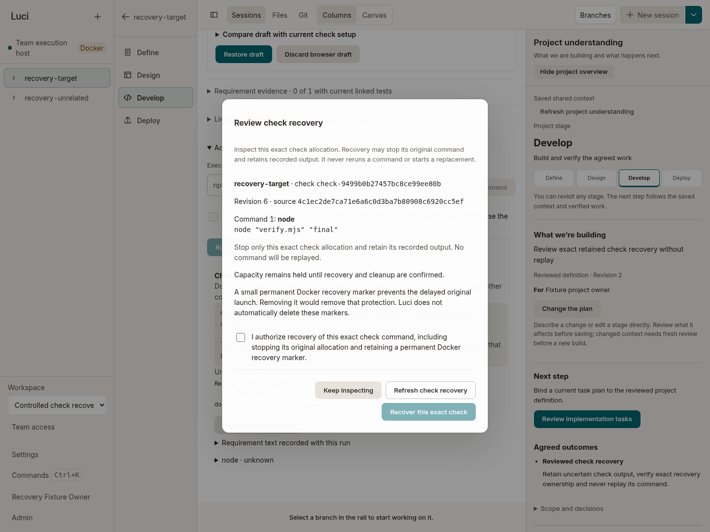

# Check recovery attempt 6 — reviewed recovery observed, overall run failed

This installed Linux attempt used **product and helper `da8a6ff29d5f4b15b674087076855404456f2d9d`**. The target's actual lost-Create-acknowledgement recovery reached explicit UI review/consent, a positively acknowledged permanent fence, and exact charge release. **The overall attempt failed** at the final assertion that the proxy failure list must be empty. Six check statistics GETs had been refused as `sdk-check-request-shape-refused`. The original failed receipt remains unchanged; a later CLOUD-040 helper correction cannot turn this attempt into a pass.

The run made **zero worker allocations and zero external model calls**. It is not Windows acceptance, live-provider quality, a sustained four-project result, or full local-product acceptance.

## Exact identity and failure

- Driver: `2026-10-09T01:16:37.253Z`–`01:17:47.194Z`; wrapper exit **1**. These are retained UTC timestamps, corresponding to **11:16–11:17 a.m. Brisbane** on 9 October.
- Package: **3,310 members recorded matching**, Linux archive SHA-256 `0b8c223789f1914cf8a533cb9204732cef43f1288e2a0f8a69ce14695c13b9fc`, binary SHA-256 `33c8f04cd8ac3ca4bb7193cbcb1870751ccfe96c43aca369a419bc3ad5641dca`, web-index SHA-256 `76a4ecec572e89cda1b0f9ddbe50f090622544d7ee66bb4ac2f8c14448866dd6`.
- Image: `sha256:333effcf40151e2411fa036b4581113be2af7f8d441bf9566f1cce6e7f208e98`.
- Actual transport totals: **3 Creates** (2 checks and 1 fence), **1 Start** (historical check only), 0 workers, 0 dropped observation rows.
- Failure: `explicit-current-owner-recovery`, `AssertionError / ERR_ASSERTION`, pinned `recovery-scenario.mjs:241`, after the scoped recovery assertions and before the scenario's final return.

The [outcome projection](attempt-outcome.json) retains all six refused GET rows, exact check identities, timestamps and failure locations. The raw query strings were **not retained**, so their exact rejected wire form is not claimed. Five refused requests concern the target and one the historical check. The failure array contains one deduplicated error name, not six distinct names. The [complete failed report](result/report.json.gz), [journal](result/diagnostic-journal.jsonl.gz), all 17 phase receipts, wrapper logs and three screenshots are preserved.

The [11 captured helper files](source-verification.json) all match the exact `da8a6ff2` Git blobs. They are the executed bytes, including the old proxy, regardless of later worktree edits. Historical defaults inside the helper's source manifest do not replace the explicit product/helper selection recorded in [invocation.json](invocation.json).

Archive/member integrity and licensing are publisher-held package evidence; the archive is not uploaded in this capsule and independent binary retrieval is not claimed. The [package verification](package/package-integrity.json) and [build result](package/build-result.json) recorded 347 licensed components and zero missing licenses. The original build log is retained. The runtime image's retained build/source receipt is [image-provenance.json](image-provenance.json).

## Scoped recovery observations

1. The unrelated historical check `check-26af759ce4320e18627d76a5` in `p-f0038548` actually ran `node verify.mjs final`, returned exit 0 and `RECOVERY_CHECK_OK`, then recorded exact cleanup and no held resources. Its nonempty history and both projects' source trees were preserved through the subsequent recovery assertions.
2. Target `check-9499b0b27457bc8ce99ee80b` in `p-b127f5a3` was submitted once with actual browser execution consent. Docker acknowledged Create **201** for container `71deb55a1d0bd1fa64b97105b1f2d5207fbb6c860fa5f101d3738610fd72b8c3`; the proxy drained and deliberately lost that acknowledgement before the product could receive it. The product recorded **unknown / check_create_unconfirmed**, retained allocation `checkexec-f37fa411f0b542f281f61d7d` with a **1,024 MiB / 1,000 mCPU** charge, and sent **no target Start**. A daemon ACK is not a product ACK.
3. Reading and dismissing the actual review caused no recovery mutation. Revoking the reviewed editor's current Edit grant produced **403**; a stale reviewed revision produced **409**. The reached assertions require unchanged ledger, target/history receipts, source hashes and Docker mutation intents. Subsequent current review and receipt reads remained coherent. This is scoped installed evidence for review stability, not a claim about every observer ordering or a replacement for CLOUD-038's controlled before/after regression.
4. The owner reopened the actual dialog, explicitly checked the recovery acknowledgement, and sent exactly one successful recovery POST with the current revision/digest. The transport records original immutable-container **Delete 204**, absence, fence **Create 201** and the exact image-free fence inspection. The persisted fence proof is **retired**; the whole private ledger's active charge and the owner's public reservation display fall from **1 / 1,024 MiB / 1,000 mCPU** to **0 / 0 / 0**.
5. The target becomes **cancelled / check_stopped_by_review**, revision **9**, `resourcesHeld=false`, `evidenceStatus=unverified`; command cleanup is confirmed, output stays empty, and exit code stays null. It does **not** become a passing check. Pinned `assertRetired` and later preservation assertions executed before the final failure; the final API response body was not returned into the failed scenario result. The [actual completed-recovery screenshot](result/recovery-complete-marker-retained.png) and [failed-stage screenshot](result/failed-stage.png) retain the cancelled/unverified UI state.
6. The exact target has **one Create and zero Starts**. Recovery did not replay its command or allocate a replacement worker. Its permanent marker remains `f810ed45a390122637e062b2f0c79c603a49a80a135e9be7a890006bab85f12b`. Recovery GET reached `complete` with no further recovery method/digest. The marker was not removed.

This default run did **not** use `--charged-witness`: preservation of unrelated completed history is observed, but isolation from a simultaneously charged unrelated allocation remains unverified here. No post-recovery task integration, new workload or deployment is credited.

## Closure and retained marker

All five startup handles closed. Controller, proxy and browser cleanup phases completed; the proxy reported zero pending requests, active handlers and body bytes, no uncertain mutation, and positive drain. The driver recorded **zero active check leases and one retained permanent fence**. This is not an empty Docker inventory or complete disposable-fixture retirement.

The separate [read-only closure receipt](independent-scoped-closure.json), observed at `01:22:54.541388Z`, records the same exact marker, zero Docker volumes and zero active leases. The [marker inspection](retained-marker-inspection.json) binds its immutable ID, never-started `created` state/PID 0, empty image, no mounts/environment/network, read-only root, dropped capabilities, one-PID limit and 6 MiB/100 mCPU configuration. The [retired proof](retained-fence-proof.json) remains intact. Ledger SHA-256 is `bfef13440edb6e1ed2437427d8fbc17c2b2d011cfcc03426878b3a986107b6fd`.

Of **15 exact PID/start identities**, **13 were absent and two were exited Chromium zombies adopted by PID 1**. No known recorded identity was live. Three other process environments were unreadable, so this is not a whole-machine zero-process claim. All **110** fixture files were unchanged in the root's independent inventory comparison. Raw private inventory rows and ledger bytes remain publisher-held; this publication does not claim an independent reread of those contents.

The marker is intentional launch protection while the fixture could resume. It must not be removed merely to obtain an empty inventory. Any later terminal fixture archival/retirement must be separately evidenced, positively prevent fixture resumption and late transport, and preserve the original proof; marker removal is not product capacity-release proof. Publication itself performed no daemon call, signal, service launch, fixture write or marker deletion. Earlier failed fixtures remain untouched.

## Resource scope

[Resource observations](resource-observations.json) retain source-bound calculations and all [85 original samples](observation/samples.jsonl.gz) across **89.619 seconds**. There are **62 samples with observed control-plane cgroup data / 124 observed rows**; independently recomputing the visible-ancestor effective-memory formula gives **zero mismatches**. Minimum sampled effective available memory is **9,989,062,656 bytes**, versus minimum physical available **21,004,247,040 bytes**. These minima are separate sampled quantities, not atomic admission inputs.

Check coverage is **five identity samples and zero check cgroup-usage samples**. The target never started. The frozen sampler explicitly reports 22 `check-label-set-invalid` observations while the inert fence is retained; no sample was silently dropped or relabelled as runnable-check usage. Process RSS peaks are **1,249,251,328 bytes summed across observed owned processes**, including **835,383,296 browser bytes** and **236,740,608 control-plane bytes**. RSS sums can double-count shared pages and do not include attributed Docker-daemon/VM costs.

The observer's own interpreter averaged **0.26148 CPU core** across 89.689 seconds; this excludes its children and daemon work and was not subtracted from resource data. There is no pre-run idle baseline, sustained throughput, human-input latency or whole-computer responsiveness claim.

## Reproduction and publication

[REPRODUCE.md](REPRODUCE.md) gives the exact pin, source-binding generator and invocation with environment-specific paths made explicit. All executed helpers and the sampler are retrievable here and at the pinned commit. This Linux harness requires a dedicated, initially empty Docker daemon and an explicitly allocated test window; do not run it on the user's shared Windows daemon or point it at an old fixture. The original failed fixture is evidence, never reproduction input.

[`publication.json`](publication.json) binds original and stored hashes/byte counts. Gzip uses `mtime=0` and retains decoded hashes. Package host paths and private closure inventory are omitted only through documented projections; original bytes remain unchanged. [`publication-validation.json`](publication-validation.json) records recursive JSON/decoded-text scans for exact private roots and known retained credential values, plus visual review of the three screenshots. Auth values were collected only in memory from the exact private fixture auth file; ephemeral credentials and universal secret detection are not claimed. [`SHA256SUMS`](SHA256SUMS) covers every capsule member except itself.
